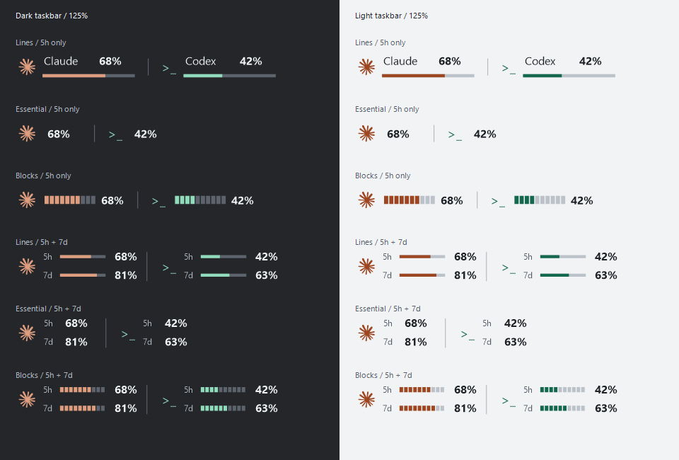
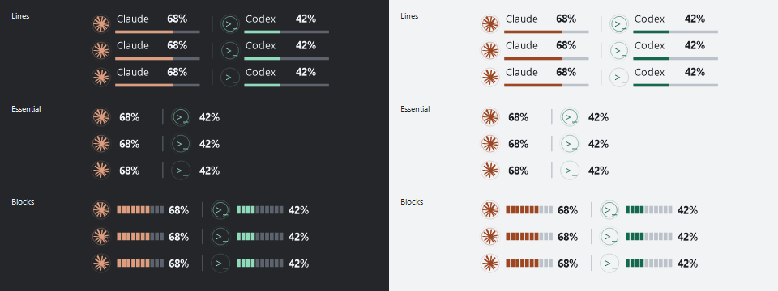
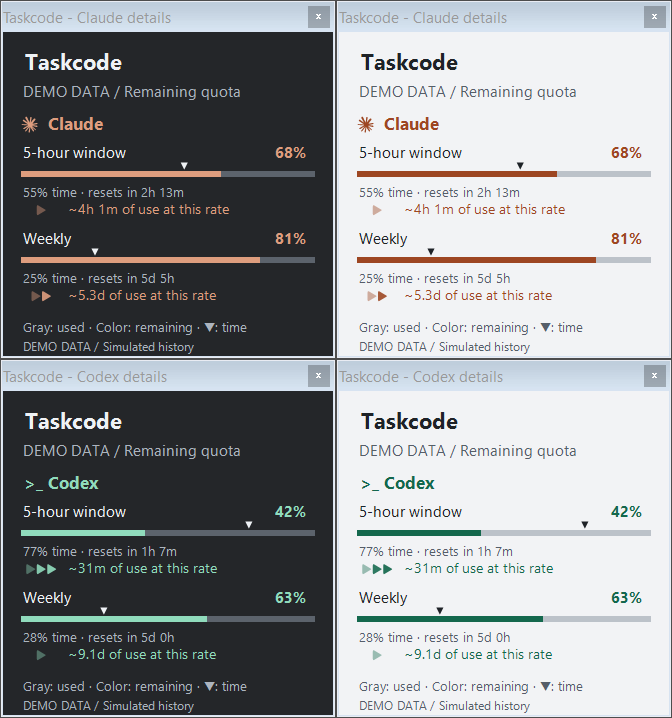
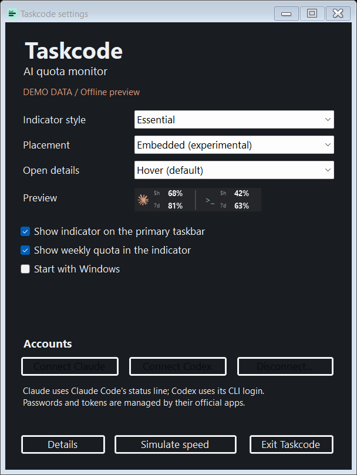

<p align="center"></p>

<h1 align="center">Taskcode</h1>

<p align="center">Your AI quota, on the Windows taskbar.</p>

Taskcode is a Windows taskbar companion for monitoring Claude and Codex quota without interrupting your work. Its indicator sits to the left of the taskbar's hidden-icons arrow, with details available on hover or click.

**Status: experimental Windows prototype.** The app connects to Codex through its official CLI and receives Claude quota through Claude Code's status line. Taskbar embedding, packaging, and wider Windows compatibility are still experimental. See [account setup and privacy](docs/ACCOUNTS.md).

## Current prototype

These previews are rendered by the current application with **sample data**. They show implemented controls and styles, rather than proposed designs. Indicator previews use sample light/dark backgrounds to demonstrate contrast; the actual taskbar strip is transparent.

### Three indicator styles



| Style | Indicator | Availability |
| --- | --- | --- |
| Lines | Names and thin bars | Default |
| Essential | Icons and percentages | Configurable |
| Blocks | Segmented meters | Configurable |

Weekly readings are optional and disabled by default. Enabling them adds labeled `5h` and `7d` rows within the selected style. There are three display styles; placement is a separate technical setting.

Active local turns show a subtle **Ripple** around the provider symbol, in its own accent color. This follows execution signals rather than quota polling. See [activity detection and limitations](docs/ACTIVITY.md).



### Quota details



Each provider has its own panel with five-hour and weekly quota, elapsed-period markers, and recent-consumption projections with animated filled arrows. Hovering or clicking Claude opens Claude's panel; Codex opens its own. Only one panel is visible at a time. The preview above uses simulated values in both themes. Normal startup uses account data, and unavailable or stale quota appears as `--`.

### Settings



Settings open from the tray icon. Windows startup is opt-in; closing the settings window keeps Taskcode running in the tray.

Use **Connect Codex** to reuse the official CLI login or open its sign-in flow. **Connect Claude** installs a local Claude Code status-line bridge and preserves the original status line. Claude Code must supply quota observations; this does not independently connect the Claude website or desktop app. Read [connection instructions](docs/ACCOUNTS.md) before removing the bridge.

## Planned first version

- Windows, with initial validation on Windows 11.
- Claude and Codex.
- Remaining quota and reset times, when available from the data source.
- A details panel on hover.
- Style selection under **Indicator style** in the settings window, with an immediate preview and a saved preference.
- Indicator style independent of light or dark mode.
- Optional weekly quota in the taskbar indicator, disabled by default.
- Recent-consumption projections with one to three animated, filled arrows when sufficiently frequent source observations are available.
- Transparent taskbar indicator with colors following the Windows taskbar theme.
- Tray icon for settings and exit, plus optional Windows sign-in startup (off by default).
- Explicit states for stale data, connection errors, and unavailable quota information.

## Development

The initial probe uses C# / Windows Forms and the Windows .NET Framework compiler, without downloading dependencies. The final application stack remains open pending integration validation.

```powershell
.\scripts\build-probe.cmd --test
.\out\probe\Taskcode.Probe.exe
```

See [prototype instructions](docs/PROTOTYPE.md) and the [integration investigation](docs/TASKBAR-INTEGRATION.md) for requirements, evidence, and known limitations.

See the [roadmap](ROADMAP.md) and [design decisions](docs/DESIGN.md).

## Contributing

Interface suggestions, compatibility reports, and technical discussion are welcome. Do not include tokens, cookies, authentication files, or logs containing personal data in issues or pull requests.

## Inspiration

[Codenotch](https://github.com/vinzdg/codenotch) is a functional reference for this project. This repository currently contains no Codenotch code. Any future reuse must include a review of the applicable license and attribution requirements.

## License

Taskcode is licensed under the [MIT License](LICENSE).

Provider artwork is covered separately in [third-party notices](THIRD-PARTY-NOTICES.md).
