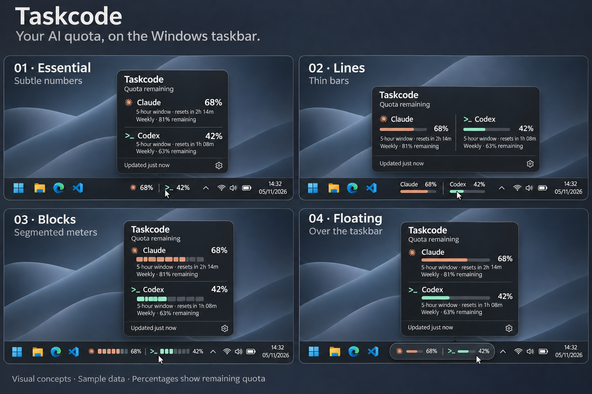

# Taskcode

Your AI quota, on the Windows taskbar.

Taskcode is a planned quota monitor for Claude and Codex, designed to show your remaining allowance without interrupting your work. The indicator will sit to the left of the taskbar's hidden-icons arrow, with details available on hover.

**Status: experimental positioning prototype.** A runnable Windows probe demonstrates the three styles and tests taskbar embedding and overlay placement with sample data. Real provider connections and production compatibility are not implemented.

## Visual concepts



AI-generated concept mockup. All values are illustrative; percentages show **remaining quota**. The position shown does not establish technical feasibility.

Three display styles are planned:

| Style | Indicator | Planned availability |
| --- | --- | --- |
| Lines | Names and thin bars | Default |
| Essential | Icons and percentages | Configurable |
| Blocks | Segmented meters | Configurable |

The Floating concept illustrates an overlay placement option if taskbar integration proves impractical. It is not a fourth selected display style.

## Planned first version

- Windows, with initial validation on Windows 11.
- Claude and Codex.
- Remaining quota and reset times, when available from the data source.
- A details panel on hover.
- Style selection under **Settings > Appearance > Indicator style**, with an immediate preview and a saved preference.
- Indicator style independent of light or dark mode.
- Optional weekly quota in the taskbar indicator, disabled by default.
- Recent-consumption projections with one to three animated, filled arrows, currently demonstrated using simulated histories.
- Transparent taskbar indicator with colors following the Windows taskbar theme.
- Explicit states for stale data, connection errors, and unavailable quota information.

## Development

The initial probe uses C# / Windows Forms and the Windows .NET Framework compiler, without downloading dependencies. The final application stack remains open pending integration validation.

```powershell
.\scripts\build-probe.cmd --test
.\out\probe\Taskcode.Probe.exe
```

See [prototype instructions](docs/PROTOTYPE.md) and the [integration investigation](docs/TASKBAR-INTEGRATION.md) for requirements, evidence, and known limitations.

See the [roadmap](ROADMAP.md) and [design decisions](docs/DESIGN.md).

## Contributing

Interface suggestions, compatibility reports, and technical discussion are welcome. Do not include tokens, cookies, authentication files, or logs containing personal data in issues or pull requests.

## Inspiration

[Codenotch](https://github.com/vinzdg/codenotch) is a functional reference for this project. This repository currently contains no Codenotch code. Any future reuse must include a review of the applicable license and attribution requirements.

## License

Taskcode is licensed under the [MIT License](LICENSE).

Provider artwork is covered separately in [third-party notices](THIRD-PARTY-NOTICES.md).
