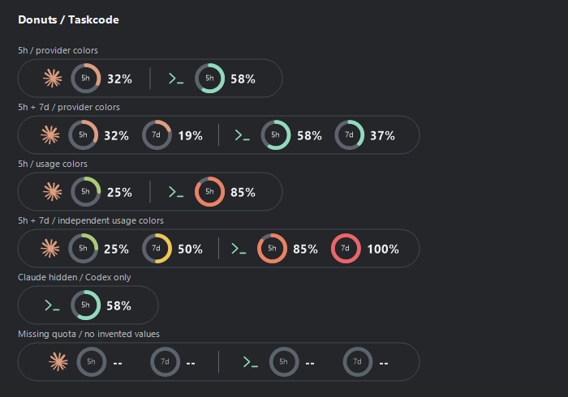
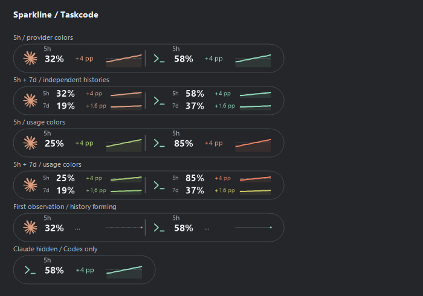
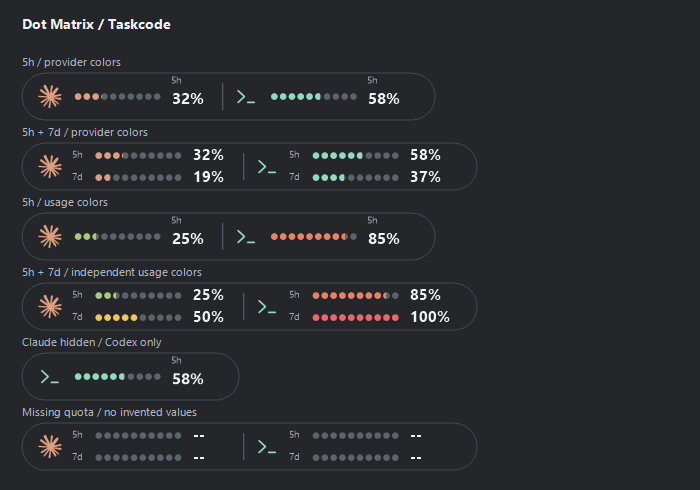
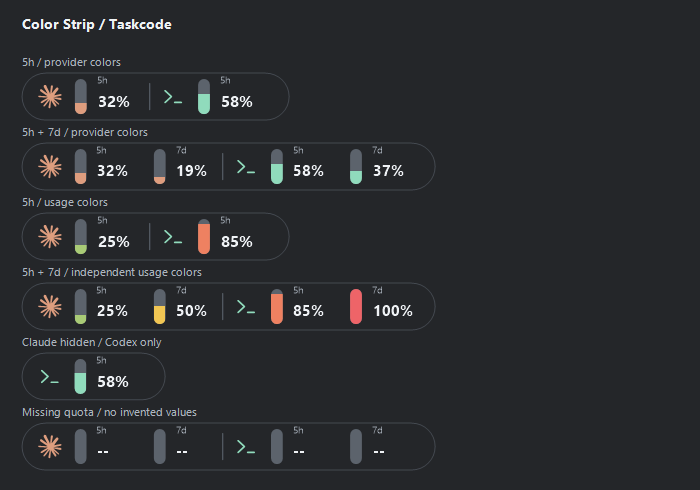

<h1 align="center">Taskcode</h1>

Claude and Codex quota, on your Windows taskbar.

Taskcode puts a compact dark capsule beside the system tray. Check five-hour and weekly consumption, reset times and usage estimates without switching away from your work.

**[Download the latest release](https://github.com/angelosc1/taskcode/releases/latest)** | [Installation guide](docs/INSTALL.md) | [Account setup](docs/ACCOUNTS.md) | [Report an issue](https://github.com/angelosc1/taskcode/issues)

## Install

1. Open [Releases](https://github.com/angelosc1/taskcode/releases/latest) and download `Taskcode-Setup-<version>-win-x64.exe`.
2. Run the installer. It installs for your Windows user and adds a Start menu shortcut.
3. Open **Accounts** and connect Claude and/or Codex. The account windows can install the official CLI if needed.
4. Choose your style in **Appearance**. **Essential** is the default.
5. Optionally enable **General > Start with Windows**. It is off by default.

> **Windows protected your PC?** The current installer is unsigned, so Microsoft Defender SmartScreen may show an unrecognized-app warning. If you downloaded it from this repository's official Releases page and trust the file, click **More info**, then **Run anyway** to continue. The publisher will appear as **Unknown publisher**. [Step-by-step instructions](docs/INSTALL.md#windows-smartscreen-warning).

Requires **Windows 11 x64** and **.NET Framework 4.8**, normally included with Windows 11. This is an early release; taskbar integration is still experimental across different Windows configurations. The initial installer is not code-signed. See [installation, portable use, removal and troubleshooting](docs/INSTALL.md).

## On the taskbar

| Style | Display |
| --- | --- |
| **Essential (default)** | Provider icons and percentages |
| **Lines** | Names and thin meters |
| **Blocks** | Segmented meters |
| **Donuts** | Mini rings beside provider icons, with percentages and `5h` / `7d` labels |
| **Sparkline** | Current consumption, change in percentage points and a compact measured-history chart |
| **Dot Matrix** | Ten small dots fill progressively with consumed quota |
| **Color Strip** | A compact vertical strip fills from bottom to top beside the percentage |

Donuts supports one five-hour ring or both five-hour and weekly rings through the existing weekly switch. Usage colors apply to each ring independently; provider icon colors stay fixed.

Sparkline uses actual quota observations collected while Taskcode is open. Its variation is the change across visible samples, up to 30 minutes; each chart adjusts its vertical scale with a minimum ten-point range. The weekly switch adds a second row. History starts empty in live mode, restarts after rollover or a source interruption, and clears on disconnect. It is a consumption trend, not a forecast or financial gain/loss.

Dot Matrix and Color Strip support five-hour-only or combined five-hour/weekly readings with independent usage colors. Their meters remain empty when quota is unavailable.

All styles use the same dark capsule, regardless of the Windows theme. Weekly readings and green-yellow-red usage colors are optional and off by default. Values show **consumed quota**. Provider logos keep their own colors.

A subtle **Ripple** follows observed local execution. Usage arrows appear only inside Details. Local activity detection covers Claude Code and Codex sessions; it does not observe activity in the Claude website or desktop app. [How activity is detected](docs/ACTIVITY.md).

## Details

Hover opens the relevant provider's card immediately; those cards close when you move away. Click-only opening is also available. Explicit clicks and the settings Details action keep the card open until you choose its close button or click outside it. Cards show consumption versus elapsed time, reset countdowns, and usage projections without taking focus from your current app. Details opened from settings remain usable when the taskbar indicator is paused or the appearance preview is hidden.

After a Claude session resets, a fresh zero-use reading without a new reset shows all five hours available. Time starts only from the next provider-confirmed session, not a local timer.

Forecasts use recent quota observations where available, with a clearly labelled **period avg** while waiting for a measurable change. They pause when local execution stops. They are estimates, not provider guarantees. [How estimates work](docs/USAGE-SPEED.md).

## Settings and updates

**Accounts > Manage providers** adds Cursor, Antigravity, GLM Coding Plan, Grok, GitHub Copilot, OpenCode Go, Command Code, Qoder and DeepSeek Harness. All nine are disabled by default, including after upgrades. Connect each provider explicitly; disabled providers perform no credential reads or polling and take no taskbar space. The connection screen offers the appropriate official app/CLI login, optional encrypted key entry and connector setup. [Provider connections and requirements](docs/OPTIONAL-PROVIDERS.md).

Additional provider cards show the quota windows that provider actually publishes. DeepSeek Harness shows local daily token/session counts, without a quota percentage or cost estimate. Execution Ripple and consumption-speed forecasts remain available for Claude/Codex.

- **Appearance:** style, hover/click, weekly quota and optional usage colors.
- **Accounts:** sign in, reuse an existing CLI account, refresh or disconnect.
- **General:** indicator visibility, Windows startup, placement and updates.
- **Language:** **System** (default), **English** or **Português (Brasil)** under General. Switching applies immediately; unsupported system languages fall back to English. [Contribute a translation](locales/README.md).

**General > Check for updates** checks the official GitHub release. Automatic daily checks are enabled by default and can be turned off. When an update is available, choose the **Install** button. Taskcode verifies the download's SHA-256, runs the installer and restarts in the tray. Accounts and preferences stay in your user data directory. Updates are never installed without your click. Portable copies open the release page for a manual update. [Update details](docs/INSTALL.md#updates).

**Close**, the header close button and Escape hide settings. To stop Taskcode completely, right-click its tray icon or taskbar indicator and select **Exit**.

## Privacy and limitations

There is no Taskcode account, cloud backend or analytics. Official clients own authentication; Taskcode reads only the local credentials required for its documented provider connection. Quota requests go to the provider, and update checks go to GitHub. Prompts, responses and credentials are never included in release files or public preview images. [Privacy](docs/PRIVACY.md) | [Connection details](docs/ACCOUNTS.md).

Claude quota normally refreshes every five minutes, with targeted reset/session-start checks; Codex is normally queried every ten seconds. Internal provider endpoints may change. Missing, stale or disconnected quota shows `--`. Auto-hide, Explorer restarts, multiple monitors, fullscreen and scaling need broader compatibility testing. Overlay is available if embedded placement misbehaves.

*Images are rendered by the actual application with sample quota values, without personal account data.*

## Development

Taskcode uses C# / Windows Forms and .NET Framework, with no NuGet dependencies. [Build and test](docs/DEVELOPMENT.md) | [Release process](docs/RELEASING.md) | [Validation results](docs/VALIDATION.md) | [Roadmap](ROADMAP.md) | [Design decisions](docs/DESIGN.md).

Code fixes and community translations are welcome. See [Contributing](CONTRIBUTING.md).

## Credits and license

[Codenotch](https://github.com/vinzdg/codenotch) inspired the quota-monitoring workflow and the MIT-licensed Claude connection approach. Taskcode's UI is its own implementation. [Third-party notices](THIRD-PARTY-NOTICES.md).

[MIT License](LICENSE). Provider artwork is covered separately in the notices.
