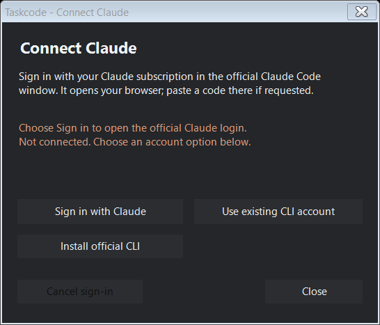
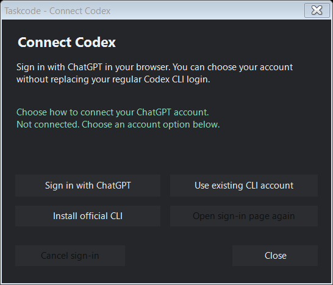

# Account connections

Click **Connect Claude** or **Connect Codex** in settings. Each button opens a connection window with two explicit choices:

- **Sign in with Claude / ChatGPT** opens the official sign-in flow so you can choose your account. These logins use a separate Taskcode profile; they do not replace your normal CLI account.
- **Use existing CLI account** reuses the account already stored by the corresponding local tool.

The window shows progress, errors, and the signed-in email when the source supplies it. Use **Cancel sign-in** to cancel an owned login process or Codex browser request. Closing the window leaves sign-in running so you can finish in the browser and reopen it. If the official CLI is absent, **Install official CLI** opens its installation in a visible window; then choose Sign in.

## Claude

Taskcode finds the standalone Claude Code CLI in its native, npm, pnpm, Volta, or PATH location. It excludes Desktop-owned bundled copies because those can use a different credential store. **Sign in with Claude** runs the official `claude auth login --claudeai` in a visible window. Complete the browser sign-in; if Claude asks for a code, paste it into that official sign-in window. Passwords and authorization codes are not entered into Taskcode. See the [official CLI reference](https://code.claude.com/docs/en/cli-reference).

New Claude sign-ins use `%LOCALAPPDATA%/Taskcode/accounts/claude` through `CLAUDE_CONFIG_DIR`. The official CLI manages the credential file. Taskcode reads its access token into memory to authenticate a GET to `https://api.anthropic.com/api/oauth/usage`, following [Codenotch's Windows approach](https://github.com/vinzdg/codenotch/blob/main/windows/codenotch/src/usage.rs). It never logs the token, copies it to Taskcode settings, sends it to a Taskcode server, or reads browser cookies. This is an internal provider endpoint and may change or reject third-party access.

The request uses TLS 1.2 with strong cryptography, disables redirects, times out after fifteen seconds, and reads only the five-hour and weekly usage windows. The shipped `.exe.config` enables modern .NET Framework networking; keep it with the executable. Normal checks are at least five minutes apart. Rate-limit responses trigger exponential backoff starting at sixty seconds, capped at fifteen minutes unless the server requests a longer wait. Manual refresh does not bypass that server cooldown. Expired or rejected sessions show an explicit message and can be signed in again.

When using the existing local account, the Claude Code status-line bridge remains a fallback and can provide fresher event-driven observations. Connecting preserves the original status line and adds only Taskcode's lifecycle hooks for [Ripple](ACTIVITY.md). Existing hooks remain intact. Quota can be refreshed from the authenticated endpoint without an active Claude Code conversation; execution activity still depends on local Claude Code signals, not the Claude website or Desktop app.

## Codex

**Sign in with ChatGPT** starts the official Codex app-server browser flow using `%LOCALAPPDATA%/Taskcode/accounts/codex` as `CODEX_HOME`. The default browser opens even if your regular CLI is already signed in. Finish login there; the connection window updates automatically. **Open sign-in page again** retries opening the same pending sign-in URL. Authentication itself is handled by the official client and browser.

**Use existing CLI account** reads your ordinary Codex profile instead. Taskcode never reads `auth.json` or copies Codex tokens. The integration performs initialization, calls `account/read`, and reads `account/rateLimits/read`; it does not start conversations or model turns. See the [official protocol](https://developers.openai.com/codex/app-server/). An API-key login does not provide ChatGPT subscription quota.

Windows discovery supports the standard npm x64 installation, `.local/bin/codex.exe`, and native `codex.exe` on PATH. The installation button uses the official `@openai/codex` npm package and requires Node.js/npm. Codex is queried approximately every ten seconds, or two seconds while waiting for browser sign-in. Failures back off sixty seconds. A pending browser login expires after fifteen minutes.

## Freshness and identity

The strip shows consumed subscription quota, not context size or API spending. Unknown, missing, expired, disconnected, and stale readings appear as `--`. Codex readings expire after two minutes; Claude readings after six minutes to allow its five-minute usage interval. Hover the provider identity or percentage in Details for source/freshness information; connection messages remain in settings. Successful responses with missing windows clear them; temporary failures preserve recent readings until they expire.

Only provider-reported 300-minute and 10,080-minute Codex windows are assigned to five-hour and weekly quota. Reset timestamps anchor time markers. Fractional percentages are retained for speed estimates; displayed values are rounded. Repainting, polling an unchanged cache, and signing in do not fabricate consumption samples.

Taskcode currently monitors one selected account per provider. You can switch between the separate Taskcode sign-in and the existing CLI account. Independent account switching does not switch the account inside an already-running coding tool. Account identities are displayed locally when available and are not included in public preview images.

## Removal and development

**Disconnect** stops monitoring and clears readings. Claude disconnect also restores the original status line and removes only Taskcode's hooks. It does not sign you out of your regular CLI. Official-client credentials in Taskcode's separate profiles remain local so reconnection can reuse the profile; remove those profile folders only after exiting Taskcode if you want to remove those saved sessions. Disable Windows startup and disconnect the Claude bridge before removing the application.

`--demo`, self-tests, and tray tests use offline values and never authenticate or change Claude settings. `--login-flow-check` starts and cancels a separate Codex browser request without opening a browser or authenticating. The ignored output contains only sanitized results. `--connect-claude` installs the optional bridge; it is not an account sign-in command.

The adapted Codenotch behavior is MIT-licensed and credited in [third-party notices](../THIRD-PARTY-NOTICES.md). Taskcode remains an experimental Windows application; endpoint availability and official client versions determine what can be read.

Connection errors preserve recent readings until their freshness limit, then show `--`; polling retries automatically. Codex cleanup tolerates a broken app-server pipe. Unexpected process errors are recorded in `lifecycle.log` beside the executable using exception types and method names only, without messages, credentials, or service responses. The log also distinguishes requested exits from an unexpected error.
