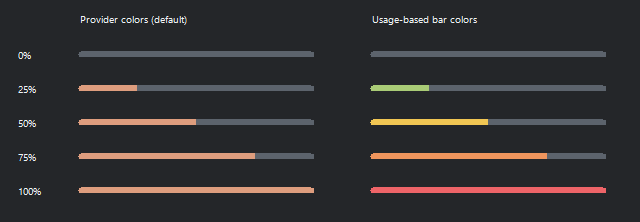

# Design decisions

## Placement

Preferred: inside the taskbar, to the left of the hidden-icons arrow. Fallback: an overlay in that same area. Avoid covering the clock, system tray, or other applications' buttons.

Integration and overlay are technical approaches to validate, independent of the seven display styles.

## Approved styles

1. **Essential (default):** compact symbols and percentages.
2. **Lines:** names and thin horizontal bars.
3. **Blocks:** horizontal segmented meters.
4. **Donuts:** small consumption rings beside provider marks, with percentages outside and period labels inside. One ring shows `5h`; the weekly option adds a `7d` ring. Each ring independently follows the optional usage palette.
5. **Sparkline:** consumption percentage, measured change in percentage points, and a time-spaced mini trend. Weekly mode adds a second row. Colors describe consumed quota, without assigning profit/loss semantics to the variation.
6. **Dot Matrix:** ten dots display consumed quota; the last dot fills partially for fractional steps. Weekly mode adds a second labeled row.
7. **Color Strip:** a rounded vertical meter fills from bottom to top with consumed quota. Weekly mode adds a second labeled strip and percentage beside the first.

All seven styles render inside the same dark rounded capsule with a subtle border. Donuts centers each provider's actual content within its cell and places separators on the shared cell boundaries, keeping the exterior padding and separator spacing balanced. Its smaller rings retain clearance from the capsule edges. Sparkline uses tighter value/chart spacing and compact weekly rows.

Sparkline keeps up to 120 real observations per window, bounded to 30 minutes, in memory. Cached readings and rendering never create observations. Period changes, decreases from rollover/corrections, account switches, source errors and long gaps restart the series. A single point shows a forming history rather than an invented line. Horizontal spacing uses observation timestamps; vertical scaling has a minimum ten-percentage-point range. Its delta is measured over the visible observations, not an extrapolated rate.

Weekly readings are opt-in through **Show weekly quota in the indicator**, disabled by default. Each provider has readings labeled `5h` and `7d`: two rows for Essential, Lines and Blocks, or two side-by-side rings for Donuts. The height stays constant; the width expands to keep both readings legible. The detail panel always retains both periods.

The **Indicator style** setting provides an immediate preview and saves the selection. Essential appears first and is the default for new preferences. Saved legacy Pill preferences load as Essential. The indicator, settings, Details, and account windows use a fixed dark palette regardless of the Windows taskbar light/dark setting. The capsule retains transparent outer corners. Windows high-contrast accessibility settings remain respected.

Settings use a compact borderless menu with Appearance, Accounts, and General navigation. Body text uses Segoe UI 9pt; the application heading is 14pt. Settings, selectors, previews, and account windows share the fixed dark Taskcode palette. Verbose instructions and placement diagnostics are kept out of the primary layout; necessary context remains available in tooltips. Both the header close control and the footer **Close** button hide only settings. **Exit** ends the tray application and is available only in the tray/indicator right-click menu.

Settings group related controls in subtly elevated rounded cards. Selected navigation uses a muted mint fill and a narrow accent marker; action buttons and selectors use rounded edges and soft borders. Appearance and General use switch-shaped controls backed by native CheckBox behavior, including keyboard input and accessible checked states. Details are read-only, non-activating tool windows: showing, switching, dismissing, or clicking their content preserves the foreground app and taskbar focus state. They separate five-hour and weekly quotas into compact rounded cards, with a provider badge, stronger period headings, rounded quota tracks, and muted timing labels. The refresh and hover behavior is unchanged by these visual surfaces.

## Optional usage colors

**Appearance > Usage-based bar colors** is disabled by default and saved as `usageBarColors`. When enabled, quota fills interpolate from green at 0% consumed through yellow at 50% to red at 100%. The setting applies immediately to Details, Lines, and Blocks, including weekly meters. Empty and unfilled space remains muted, provider logos and percentages retain their colors, and Essential has no taskbar meter to recolor. High-contrast mode keeps the system palette.

## Data semantics

Claude's five-hour session has an explicit waiting state. A fresh 0% reading with no next reset (or only the retired reset) means all five hours are available; elapsed time stays at zero. The next valid provider reset anchors the session clock, including when usage still rounds to zero. An expired cached reading is never converted into a synthetic empty session: it shows refresh pending until confirmed. Weekly timing always comes from the provider and is not restarted with the session.

Percentages represent consumed quota and must be labeled accordingly in the details panel. Claude and Codex use the same convention. Do not mix remaining and consumed percentages.

Detail bars use the same fill convention as the taskbar: colored consumed quota on the left and muted available quota on the right. A downward arrow advances from left to right as the period elapses. If the colored fill extends beyond the arrow, consumption is ahead of the time budget; if it stays behind, consumption is below that pace.

The arrow starts at zero on reset and reaches the end at renewal. Unknown or invalid time bounds hide the arrow instead of guessing. Expired data stays at the end until a new period is supplied. The tooltip includes used quota, elapsed time, and budget pace; a two-percentage-point tolerance is treated as on pace.

The prototype uses the five-hour window as the primary value, with weekly quota in details and optionally in the indicator. Provider adapters use the reported reset timestamps and documented/matched period durations; missing windows stay unavailable.

Offline preview values are simulated; normal startup uses the selected account source. See [account connections](ACCOUNTS.md) for sign-in, privacy, and provider limitations.

## Behavior

- Hover opens a panel containing only the selected provider's five-hour and weekly details. The hit regions follow each rendered style and optional weekly layout. Moving to another provider replaces the current panel; both panels are never shown together.
- Details use a compact borderless card: provider identity, consumed percentages, quota bars/time markers, a consumed-versus-elapsed percentage row, reset countdowns, and recent-speed estimates or their calculation status. App titles, native close controls, legends, source labels, and footers are omitted. Source/freshness and pace explanations remain in tooltips and accessibility descriptions.
- Both hover-opened and click-opened cards close after the pointer leaves the card and its trigger, with a 220ms grace period for crossing the small gap. Click does not pin the card. Escape also dismisses it.
- **Open details** defaults to **Hover**, with a saved **Click only** alternative. Click-only mode disables both native hover events and automatic pointer-based opening. Changing the preference dismisses the current panel immediately.
- Support click and keyboard access rather than relying exclusively on hover.
- Show the last update time and connection state.
- Make missing or stale data explicit.
- Color helps distinguish providers; text and numbers must identify them as well.
- Use the selected Ripple only during observed local execution, respecting Windows motion preferences. Idle and unknown states remain still. See [activity detection](ACTIVITY.md).

## Current visual references

The repository uses previews rendered by the current application:

- [Three implemented indicator styles](images/current-indicators.png), with weekly readings off and on, in both palettes.
- [Details panel](images/current-details.png), including period markers and recent-usage estimates.
- [Settings window](images/current-settings.png), including interaction, weekly quota, and opt-in startup controls.

These are offscreen application renders with illustrative data, not photographs of an installed taskbar or live provider readings.

## Provider motion and overflow

Provider marks use 15% extrusion and rotate around their own vertical axis with the right edge passing in front. Idle marks face forward without a reflection. Active marks use a fixed-direction diagonal glint, light side/back shading and three increasing rotation speeds. Claude/Codex follow local activity and recent-speed levels; optional providers use increases between actual quota/token observations. Details headers remain static. Windows reduced-motion and high-contrast preferences remain respected.

The taskbar capsule is bounded by the verified free gap. Overflow scrolls right to left at normal size with a spaced separator between cycles. Hovering or reading indicator Details pauses the scroll, and hit testing/anchors follow the visible provider. An unusable or unverified gap still hides the indicator rather than covering Windows controls.
