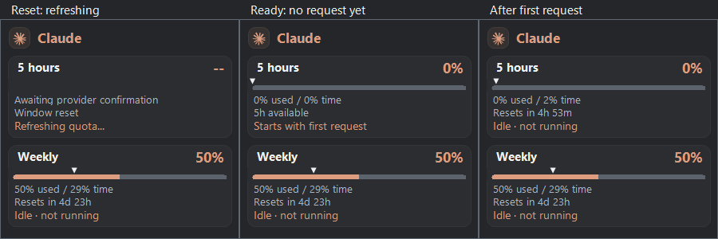

# Release validation

## 0.1.3 upgrade validation

- Local and GitHub Windows build/test/package checks passed, including exhausted quota status without arrows for both active and idle execution.
- Release publication required completing the draft through the GitHub API; draft lookup and explicit tag publication are corrected in the workflow on `main`.
- All published release bodies were checked against their Markdown source, with no PowerShell object metadata.
- The installed 0.1.1 update service downloaded and verified the public 0.1.3 installer. The real installer upgraded the running app to 0.1.3.
- Settings were byte-for-byte unchanged, the Windows startup choice was preserved, the managed Claude helper matched the installed helper, and the app restarted successfully.
- The installed 0.1.3 update service then reported **You're up to date**. GUI click-through was not automated.

## 0.1.2 session reset checks

Deterministic tests cover explicit 0% without a next reset, a retired reset on a fresh zero-use response, indefinite waiting without clock advancement, the first timed response while usage still rounds to zero, independent weekly timing, stale/unknown data, one reset-boundary refresh, retry cooldowns, activity hints, canonical-window aliases and bridge-cache round-tripping.

## 0.1.1 installation and update validation

The first release was validated locally on Windows 11 and in the Windows release workflow. Broader hardware/taskbar coverage is still pending.

| Check | Result |
| --- | --- |
| Windows build, test and package workflow | [Passed for 0.1.1](https://github.com/angelosc1/taskcode/actions/runs/42152935586) |
| Official package contents | Six allowlisted files; no preferences, account profiles or diagnostic executables |
| Per-user setup | Installed under Local AppData; Start menu shortcut and Windows uninstall entry created |
| Real official upgrade | 0.1.0 to 0.1.1 downloaded through the installed update service, verified and installed |
| Current-version check | 0.1.1 reports “You're up to date” |
| Preferences and account selection | Preserved across upgrades |
| Windows startup choice | Preserved; installation did not enable it |
| Active Claude hook helper | Matches the application helper after 0.1.1 upgrade |
| Release separation | Test classes and demo/diagnostic entry points excluded |
| Native interaction and UI regression checks | Passed, including focus, hover, colors, switch accessibility and tray lifecycle |

The updater integration was exercised through the code in the actual installed assembly and the public release asset, followed by the real installer. GUI click-through of the update button was not automated. Uninstall registration and cleanup logic were checked; full removal/reinstallation on a clean VM remains pending.

The initial packages are unsigned. Checksum verification detects mismatched download bytes; publisher code signing is separate future work. See [installation and troubleshooting](INSTALL.md).
